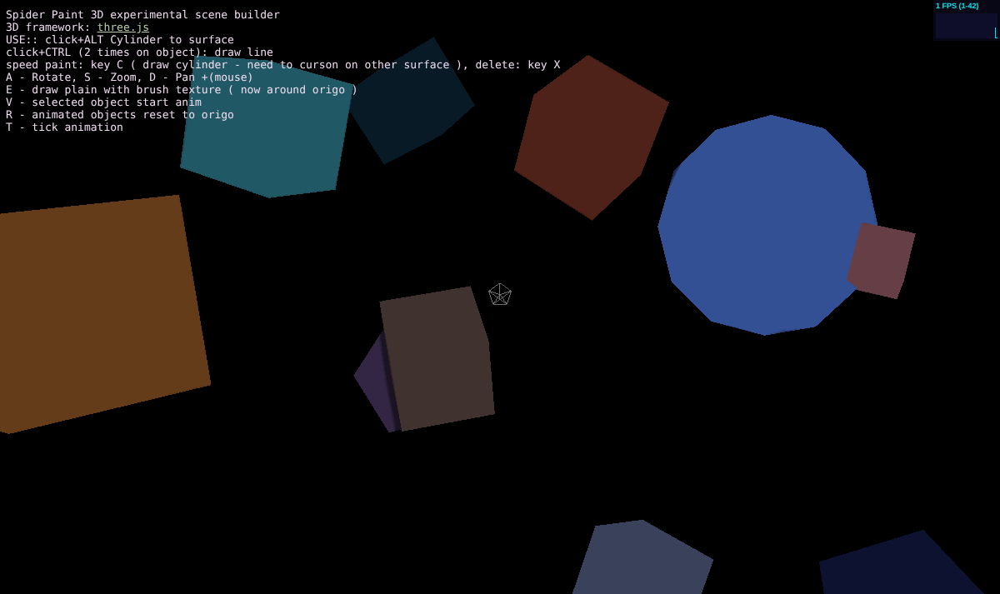
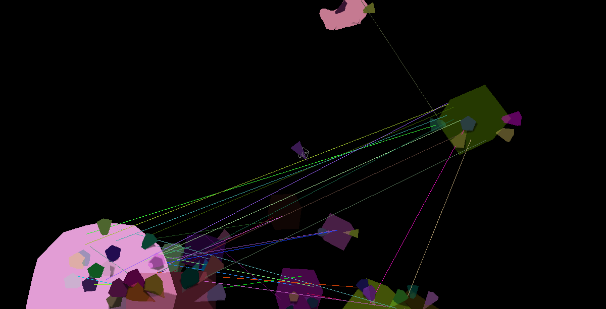
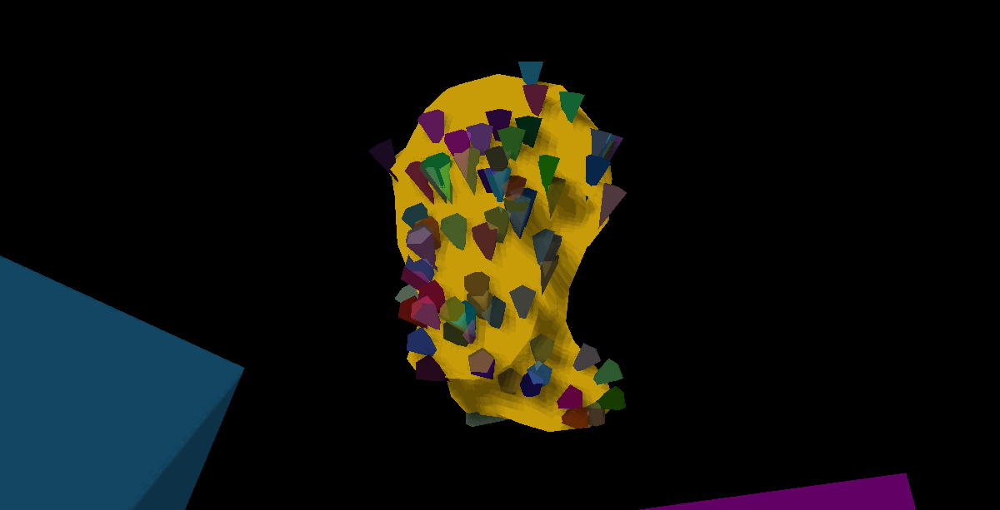

# Spider Paint







*The 2015 version as it starts, with its key help and FPS meter; then the digital spider web and the face of spider, as it drew them.*

**How these pictures came back.** The 2015 README showed two pictures: the digital spider web, which gave the program its name, and the face of spider. Both were hosted on Google (old Picasa / Google+ links), and both links now answer `403 Forbidden`: the pictures did not break, their hosting is gone. The Wayback Machine was tried next. It holds no capture of the face of spider, and for the spider web the archive was offline at the time of the search.

So the pictures were made again, by the program that made them the first time. The unchanged 2015 code (the [`2015-sept-11`](../../tree/2015-sept-11) branch, with Three.js r48 from 2012) was served locally and opened in today's headless Chrome, with a software WebGL renderer, and it still runs: the first picture is its very first screen, untouched. A small helper page loaded it with a fixed random seed and then called the program's own functions, just as the keys did: `C` puts cones on the surface under the cursor, `Ctrl` + two clicks draws a line between two surface points. For the spider web, cones were sprayed over the whole scene and lines strung between the objects. For the face, the camera was put beside the `1head.js` head model and the cones were sprayed onto it. Then the browser took the screenshots. They are not the lost files, but they are what those files showed: the same program, the same scene and the same look.

A first-person 3D world builder in the browser: you fly through the space, place, shoot and connect objects, and shape them right where they are.

Spider Paint started in 2015 as a light experimental WebGL scene builder on Three.js, an experiment about objects scattered in space and the connections between them. That version is kept, unchanged, in the [`2015-sept-11`](../../tree/2015-sept-11) branch.

This version picks the same idea up again, now on the [3Draft](https://github.com/Pengeszikra/3Draft) engine.

## Run it

It is one page, `index.html`, and two example models, `models/bridge.scene.json` and `models/globe.scene.json`. Serve the folder with any static server and open it:

```sh
npx serve .            # or: python3 -m http.server
```

(A static server is needed because the page loads the model with `fetch`; GitHub Pages works too.) The scene starts with the globe (one `U` removes it). The view starts in WebGPU and falls back to SVG by itself when WebGPU is not there.

## What it can do

**Looking around.** Drag rotates, double click resets the view, the arrow keys rotate too. A cross follows the pointer and lies flat on the surface under it. On a phone the cross aims at the middle of the screen, and four round buttons cover travel, place, delete and the view mode.

**Flying.** `w a s d r f` fly forward, left, back, right, up and down; every press is a speed step, the opposite key slows down, `Space` stops. `/` shows only the object under the cross; again: the whole scene, and the camera flies back.

**Target mode.** `T` targets the object under the cross: the camera turns onto it and from then on moves on an imaginary sphere round it, always looking at its centre. `a d r f` swing it round the object, `w s` change the distance (`w` stops at the surface), and dragging the mouse moves it over the same sphere. `T` on another object re-targets, `T` on the target or over empty space brings the camera back onto it (with no target, over empty space: the nearest object). `Tab` (`Shift` + `Tab`) switches to the next (previous) object, `Space` only sets the speed to zero, and `Esc` lets go: the camera stays where it is. The small readout in the top left corner shows the object under the cross (name, distance, faces) and the target.

**Placing and connecting.**

- `M` places a prism on the surface under the cross, or shoots one into empty space. In isolated mode (`/`) it fires a bullet: if it hits the object it sinks in and carves its shape out of it.
- `V` is the spider bar: the first `V` remembers a surface point, the second joins the two points with a thin prism.
- `X` deletes the object under the cross, `Clear` removes everything, `U` (or `Backspace`) undoes, one step at a time.
- `+ Example…` adds the stone bridge or the globe (seven continents, each its own mesh, in a half-transparent ocean) beside what is there.

**Moving.** `H` puts a move gizmo on the object (first `H`: world axes, second: the object's own axes, third: off). Drag an arrow to slide the object along it.

**Booleans.** `O` marks an object, `O` on a second one asks for the operation: `1` union, `2` A − B, `3` B − A, `4` intersect. Only closed solids are calculated; the status line shows the health of the object under the cross.

**Edit mode (`Q`): drawing on a model.**

- `V` draws lines on the surface. Points snap to vertices; two points on one face cut it, so the surface gets detail exactly where you drew. Points in the air extend the model.
- `Enter` closes a loop into a face.
- `1`, `2` and `3` move points, lines or faces (drag, or use the gizmo).
- `B` turns the spider bars into lines on the edited object.
- `X` removes lines, `Esc` steps back out.

**Materials (`P`).** Twelve starting materials (plaster, sand, wood, dark wood, concrete, slate, grass, brick, steel, gold, glass, lamp), each with `metal`, `rough`, `alpha`, `soft` and `emit` sliders and a colour; `+ new` makes a new one. `Shift` + press paints a face, `Shift` + double click the whole object, and `I` picks up the material under the cross. A face keeps the material's name, so editing a material changes every face made of it.

**Look.** `G` switches between SVG and WebGPU. `E` toggles edges and points, `L` turns the light, `C` toggles the filmic look (HDR light, glow, tone mapping), `N` smooth shading, `K` studio light. These last three only work in the WebGPU view. `?` shows all the shortcuts under the view.

Published as a Claude artifact, the scene and the palette live in a shared database, so a person and an AI see and edit the same objects.

## About 3Draft

[3Draft](https://github.com/Pengeszikra/3Draft) is a minimalist, AI first 3D engine: a model is plain data that a human, a program and an LLM can all read and write. It has an SVG and a WebGPU renderer, surface picking (with a WebAssembly kernel written in HEXAW), solid booleans and mesh editing.

The engine is not in this repo. The page imports it from jsDelivr, pinned to the 3Draft commit it was taken from. Development happens in the 3Draft repo, where this program is the viewer. From time to time the viewer becomes Spider Paint again: `node scripts/sync.mjs ../3Draft` copies the viewer, the bridge and the globe, and pins the engine to that commit.

## Install on a phone (PWA)

Open the hosted page in Chrome or Safari and choose "Add to Home screen" / "Install app". It has an app icon (`icons/`), a favicon, a manifest and a service worker (`sw.js`) that keeps the page, the models, the icons and the engine, so it also opens offline after the first visit. The service worker only runs over http(s), not from a file. When the shipped files change, raise `CACHE` in `sw.js`.

In the installed app there is no keyboard: a touch pad shows the keys as buttons: R W F / A S D, Space, Esc, Tab (next target), Paint (the cross marks the target: Paint paints that face with the selected material, pressing it twice quickly paints the whole object), M, V, X, P (the palette) and Target (T). The view stays in WebGPU. `?pwa` shows the same pad in a normal browser tab.
