# spider-paint



Interactive 3D creation and exploration, powered by **3Draft**. Based on the 2026 Fifth Percent competition sprint.

The editor opens with **no scene** and **does not request VR** until you choose Enter XR. WebXR/Meta Quest and ViRtuSH hand interactions remain available. The scene picker offers **Globe**, **Deep Sky** and **Fifth Percent VR (LARK + Deep Sky)**. Model-format tooling is retained.

## OpenAI plugin package manifest

The portable [plugin.json](plugin.json) defines the **spider-paint** listing: display name, description, developer, existing PNG icons, and both `homepage` and `extensions.com.openai.interface.websiteURL` set to [Tüskék és Gyökerek](https://tuskek-es-gyokerek.vercel.app). The companion [mcp.json](mcp.json) declares the remote MCP endpoint used by the embedded workshop (`https://spider-paint.vercel.app/api/mcp`).

These are packaging files only. They do **not** change the existing custom MCP connection or automatically publish the plugin. For a public directory submission, use the plugin submission flow **With MCP** and complete domain verification, tool checks, and review materials. The currently absent `privacyPolicyURL` and `termsOfServiceURL` must be added only after genuine public pages exist; do not use placeholders. The manifest's semantic version (`1.0.0`) is the **plugin package version**, independent of spider-paint's date-based npm version.

## Claude plugin

[plugins/spider-paint](plugins/spider-paint) is the Claude plugin: a manifest, the same remote MCP endpoint and a `spider-paint` skill that teaches the shared-workshop workflow. The repository root is also a Claude plugin marketplace ([.claude-plugin/marketplace.json](.claude-plugin/marketplace.json)), so in Claude Code: `/plugin marketplace add Pengeszikra/spider-paint` then `/plugin install spider-paint@spider-paint`. `node tests/claude-plugin.mjs` checks the package. Public Claude directory listing is a separate submission and is not done.

## Native UI refinements (Nov 2026)

- The ChatGPT-embedded editor (`?workshop=1`) starts in spider-paint's **existing Zen mode** (model full-screen), with the native **Leave zen** control, **Z**, or **Esc** to restore the full UI. Normal standalone spider-paint starts with its full UI unchanged.
- The **SYS** panel now has an icon-only keyboard button for the **tutorial keycast**. When enabled, actual pressed keys and modifiers appear briefly at the top, without intercepting events or creating a second toolbar. Its enabled state is local to the browser (`spider-paint.tutorial`). To enable it in a Zen-started workshop, exit Zen, activate the keyboard icon in SYS, then return to Zen with Z.
- **Save** is a disk icon; **Character builder** is a person emoji. Both retain their original actions, titles, and accessible names.
- `node tests/tutorial-ui.mjs` tests the native controls, Zen activation, and passive keycast; the MCP App CI workflow runs the test.

## ChatGPT-native collaborative MCP App Workshop

The primary workshop embeds the **real spider-paint editor** inside a ChatGPT MCP Apps widget (resource `ui://spider-paint/workshop-v7.html`). Its original controls, keys, selection, navigation, WebGL and XR remain authoritative: there is no second editor UI.

`open_workshop` creates a capability-scoped `session_id` and runs declarative modeling steps in the browser. The native editor publishes its scene after loading and after human geometry edits. The AI can then call `workshop_state({session_id})` to inspect the **actual** objects and revision, and `workshop_edit({session_id,revision,steps})` to enqueue further changes for **that same open workshop**. The widget polls for queued edits, models them in the browser through the 3Draft `WorkshopModel`, and imports the result into the native editor. The new scene is published back with a revision acknowledgement. A queued edit must not be mistaken for a completed edit; call `workshop_state` again to verify `last_edit.status === 'applied'`.

The older stateless `workshop_token` continuation and `#scene=` links still work. `workshop_edit` is the shared-workshop path and avoids generating a separate iframe for every agent change. A short integration guide, limits and detailed test procedure live in [WORKSHOP.md](WORKSHOP.md).

**MVP constraint:** session storage is **in memory** in the Cloud Run process (2-hour idle TTL, maximum 64 sessions). Keep Cloud Run at **one instance** for now; a cold restart, redeploy or different instance loses the session. This is not yet durable multi-user collaboration, and a server acknowledgement alone does not prove host-side rendering. Scenes are capped at 600 KB and edits use optimistic revisions to prevent stale writes. The `session_id` is a bearer capability: do not publish or log it.

Cloud Run serves the native browser app and the MCP bridge. WebGL and ordinary geometry execution remain browser-local. The earlier standalone `workshop.html` prototype is legacy diagnostics, not the product direction.

## Animated stories over MCP

`build_story` turns a model plus keyframed motions, a camera path and captions into a Spider Build v2 story (the format of
the LARK assembly and the black-hole scene). Its `open_url` plays it in the editor's Stories player, `player_url` in the bare
`player.html`, and `open_workshop({ story })` plays it inline in the chat. See [MCP.md](MCP.md#stories-build_story).

## Run locally

```sh
npm install
npm start
# or, after publishing to npm:
npx spider-paint
```

Open http://localhost:5173. No application build system is needed.

### In a terminal

```sh
npm run term -- bridge         # a scene name (default: the app's start scene)
npx spider-paint-term deepsky
node bin/spider-term.mjs globe --native     # the terminal's own renderer (no Chrome needed)
node bin/spider-term.mjs lark-4 --once --cols 100 --rows 30 > frame.ans
```

**The app way (the default when a Chrome / Chromium / Edge is found; `CHROME_PATH` names one):** the real spider-paint runs
in a headless Chrome from this checkout (`bin/term-app.mjs`, the DevTools protocol over node's own WebSocket, node 22+), so
**every key and mode works** as in the browser: flying (W A S D R F, Space), T, Tab, M, X, G, B, P, Q and the edit keys,
J, E, L, N, K, C, 9, Z… The picture is the app's own view in half blocks (rough, that is fine). Under it: **an info line**
with the HUD's important bits (EDIT, speed, the target, the object under the cross, fps; a command's answer for a moment)
and **the Enter line**, lighter while the Enter box is open (focused): what you type goes into the app's box, its list (the
targets, `/l` scenes, `/mat`, `/help`…) covers the bottom of the view, ↑↓ / Tab / Enter / Esc and a click on a row work
as in the app; in the edit mode (Q), where Enter builds, cuts or turns, **Shift+Enter** opens the box (the terminal is asked
for the kitty keyboard protocol so that it can tell Shift+Enter apart; **Alt+Enter** does the same in every terminal).
**`/q`** (`/quit`) in the box leaves. The mouse is the app's (the cross follows it, drag turns, the wheel zooms; Shift / Option + drag selects
terminal text). Ctrl+C quits. On WSL: install a Chrome or Chromium inside Ubuntu, or the native viewer starts.

A scene **file** (`.json`, `.3draft`, a sky catalogue, a story) is packed into the page's address, as an MCP link is, and
**loaded again whenever the file is saved** — edit the JSON in one window, watch it in the other.

### In VS Code

`vscode/` is a VS Code extension: the app itself in a webview tab (sharp, every key). Commands: **Spider Paint: Open**,
**Open a scene from the list…**, **Show this scene file in 3D** (the editor's `.json` / `.3draft` beside it, reloaded on
every save; also a button in the editor's title bar). Try it from the checkout: open the `vscode` folder in VS Code and
press F5 (it uses the checkout's app), or build a `.vsix` (`cd vscode && npm run package`, then
`code --install-extension spider-paint-*.vsix`); the *VS Code extension (.vsix)* workflow builds one on every push.

### The help and the markdown reader

The in-app help is the `help/` folder: `index.md` lists the sections, one markdown file each. `src/md/` reads them
(no dependencies, its own tests in `tests/md.mjs`, ready to live in a repository of its own): `markdown.js` turns the
blocks into the smallest HTML or into terminal lines, `highlight.js` colours code blocks and does not stop where the
languages nest — an ```html block's `<script>` is JavaScript, its `/** jsDoc */` gets its tags, names and `{TypeScript
types}` coloured, a `<style>` is CSS. The page's help panel and the terminal's help view (`?` in the app view, `/help
[word]` in the native one) show the same files with the same colours.

The same files as one web page: `npm run docs -- --out help.html` (or `--template page.html`, which puts the page
into a site's own header and footer). The Tüskék és Gyökerek docs page ([`dist/spider-docs.html`](https://github.com/Pengeszikra/tuskek-es-gyokerek/blob/main/dist/spider-docs.html))
is generated this way, by that site's `spider-docs` workflow, from the current `master`.

Markdown in colour on the console, with the same reader: `spider-paint -md file.md` (or `spider-md file.md`,
`npx spider-md README.md`; `-` reads stdin, `--width N`, `--page` through `less -R`, `--plain` without colours). A code
file (`.js`, `.html`, `.json`, `.rs`, `.sh`…) is shown as one coloured block. Pictures in the markdown (``, a path
beside the file or `https://…`) are drawn the way the 3D view is: half blocks, two pixels a cell (`--image-rows N`,
`--no-images`). PNG and GIF are read in node; JPEG, SVG and WebP go through a headless Chrome when there is one.

### In Vim / Neovim

New to Vim or to spider-paint? [VIM-PLUGIN.md](VIM-PLUGIN.md) walks through it step by step on Ubuntu.

The checkout is a Vim plugin too (`vim/plugin/spider-paint.vim`):

```vim
" vim-plug (lazy.nvim: { 'Pengeszikra/Spider-Paint', config = function(p) vim.opt.rtp:append(p.dir .. '/vim') end })
Plug 'Pengeszikra/Spider-Paint', { 'rtp': 'vim', 'do': 'npm install --omit=dev' }
set termguicolors mouse=a
```

`:SpiderPaint` opens spider-paint in a vertical terminal split: the buffer's scene file if it is one (saving it reloads the
view), else the start scene; `:SpiderPaint bridge` a scene of the + scene list; `:SpiderPaint path.json` a file.
`g:spider_paint_split` = `'vertical'` | `'horizontal'` | `'tab'`. In the split every key belongs to spider-paint; Ctrl+W
(Vim) or Ctrl+\ Ctrl+N (Neovim) gets back to the editor, Ctrl+C quits spider-paint. Vim 8.1+ or Neovim, node 22+.

**The native viewer (`--native`, or when there is no Chrome):** The scene is drawn with 24-bit colour half blocks (two pixels a character cell), a depth buffer and one shaded colour a
face (`src/term-render.js`, pure: no node, no DOM), with dark outlines at the silhouettes, folds and depth jumps in place of
the GPU's light play (`/outline` or `--flat` turns them off). The model fills the window. It is zen: only the picture. The mouse belongs to the program (the
terminal does not select the picture; Shift / Option + drag still selects): **drag** turns, the **wheel** zooms, the object
under the pointer lights up, a **click** turns the view round it (empty space: the whole scene). **Enter** opens a command
line under the picture: `/l scene`, `/view front|top|iso…`, `/spin`, `/outline`, `/fit`, `/zoom n`, `/ls`, `/q`, `/help`, or a name to
turn round that object; Esc closes it. Ctrl+C quits. Only the changed lines are written, inside synchronised output
(less flicker where the terminal knows it); mouse reports are gathered into at most one frame every 33 ms, so a big
scene does not fall behind the pointer. If a killed run leaves the terminal odd, `reset` brings it back.
A sky scene (deepsky, stars, a sky catalogue: a starship scene) is not meshes here but points seen from the scene's start:
stars, planets, black holes, galaxies (the biggest-looking as a small smudge) and the dust band, brightness by how big they
look. Drag turns the view, the wheel zooms (the field of view), the name of the star under the pointer shows under the
picture, a click or a typed name (`sirius`) turns the view to it. `--once` (or a pipe) prints one frame. The terminal needs 24-bit colour and
mouse reporting (iTerm2, WezTerm, kitty, Ghostty, Windows Terminal, VS Code; not macOS Terminal.app).

## Project boundaries and deployments

- **spider-paint** (`Pengeszikra/spider-paint`) is deployed to Cloud Run only, at `spider-paint.run.app`, and has the `spider-paint` npm package. There is no spider-paint Vercel deployment.
- **3Draft** (`Pengeszikra/3Draft`) is the separate 3D engine repository and npm module.

The product name is always lowercase **spider-paint**. The app header can retain **3Draft** as a quiet engine attribution.

## Cloud Run (browser app + MCP)

**Cloud Run deployment is automated in GitHub Actions** (once keyless Google Cloud IAM/WIF setup is completed). Push to the release branch (`brand.branch` in package.json) → `spider-paint MCP App` CI must succeed → `Deploy spider-paint to Cloud Run` builds and deploys that tested SHA. The deployment checks the service's `/api/version` response against the expected commit. See [the setup and verification guide](docs/cloud-run-ci.md), or run `bash scripts/setup-cloud-run-oidc.sh PROJECT_ID` once with authorized `gcloud` and `gh` credentials. **Without that setup, the workflow is present but cannot deploy.** Agents must follow the deployment rules in [AGENTS.md](AGENTS.md).


The Dockerfile now starts `bin/cloud-run.mjs` with Node.js on the Cloud Run `PORT`.
One origin serves the browser application, `POST /mcp` and the compatible `POST /api/mcp` endpoint.
It does **not** require a Vercel deployment. The legacy scene-store API is not hosted here.

```sh
# Emergency manual fallback ONLY; normal deployments run from GitHub Actions:
gcloud run deploy spider-paint --source . --region europe-west1 --allow-unauthenticated \
  --update-env-vars "SPIDER_PAINT_GIT_SHA=$(git rev-parse HEAD)"
# Check the actual Cloud Run service URL; do not guess the hostname:
gcloud run services describe spider-paint --region europe-west1 --format='value(status.url)'
```

Use the returned service URL plus `/mcp` as the ChatGPT custom MCP server URL.
Test locally with `PORT=8080 node bin/cloud-run.mjs` and `node tests/cloud-run.mjs`.
A push starts CI; successful main CI starts the Cloud Run deploy workflow. Check the deploy run and live /api/version: do not equate a green CI run with a successful Cloud Run release.

`GET /api/version`, the main editor's build stamp, the MCP tool result, and
the embedded ChatGPT workshop now show the spider-paint package version followed by
the actual build's Git commit (shortened to 8 characters in UI). The full
hash is available in the JSON response and browser title/debug panel.
The multi-stage Dockerfile captures `git rev-parse HEAD` while the source checkout is present, stores it as a private `mcp/build-sha.txt`, then removes `.git` before producing the runtime image. A build from a source archive **without** `.git` must pass `--build-arg SPIDER_PAINT_GIT_SHA=<exact-source-commit>` to Docker, or set `SPIDER_PAINT_GIT_SHA` on the Cloud Run service (as in the command above). Never substitute the latest remote branch SHA: it might not match the deployed source. If the SHA truly is unavailable, the UI shows `git ?` instead of inventing an identity. Verify the deployed image at `GET /api/version` after redeploy.

## MCP debugging and timeout correlation

The `open_workshop` response returns a random `trace_id` in `structuredContent`
and in the textual tool result; the HTTP response also supplies `x-spider-paint-trace-id`.
Use the MCP tool `debug_trace({trace_id})` to inspect a **recent** request.
Milestones include `request_received`, `steps_validated`, `response_ready`
and `request_failed`. Each event records elapsed milliseconds and response
size. **The MCP server does not know vertex/face counts:** those are determined
in the browser widget. No raw prompts, meshes, URLs or request bodies are logged.

The embedded widget optionally reports `widget_loaded`, `widget_rendered`,
`widget_empty`, or `widget_error` via `window.openai.callTool` when supported
by the host. **No widget feedback is not proof of a crash:** host sandboxes may
disallow callbacks, or rendering can time out before telemetry is delivered.
If the host times out before returning the response, inspect Cloud Run
structured logs for `component=spider-paint-mcp` around the failure time instead.
Correlate using the `traceId` field (Cloud Run may have multiple instances).

Traces are deliberately metadata-only, kept **in memory for at most 15 minutes**
and limited to 128 per instance. `debug_trace` requires the unguessable trace ID;
there is no public endpoint listing other users' requests. For durable debugging,
use private Google Cloud Logging access. This cannot observe ChatGPT's internal
timeouts, only the stages that the server or widget actually reports.

To smoke-test locally:

```sh
npm run test:mcp-app
node tests/cloud-run.mjs
```

## npm

The package name is `spider-paint`, with a CLI that hosts the app locally. The project uses its existing date-based `YY.M.DNNN` version scheme (`scripts/bump.mjs`) for npm releases as well.

```sh
npm run release -- --dry-run   # preview next date-based version, no changes
npm run release               # bump package.json, then npm publish
git add package.json
git commit -m "Release spider-paint"
git push
```

Run `npm run release` instead of `npm publish`: direct publishing is guarded against accidentally reusing an existing version. The bump happens **before** npm constructs the tarball; npm's `prepublishOnly` hook runs too late to change the version npm has already chosen. Publication still requires your npm authentication and is not automatically triggered by a GitHub push. The project is licensed under MIT (see LICENSE).

## Compatibility

- `?scene=globe`, `?scene=deepsky` or `?scene=game:lark` explicitly loads a scene.
- `?autovr` explicitly enables the previous automatic headset VR offer.
- Desktop starts empty; use **Enter XR** to enter VR manually.

Original source: https://github.com/Pengeszikra/five-percent


## Legacy local Workshop 002 (diagnostics only)

```sh
npm install
npm run workshop
# open http://localhost:5173/workshop.html
```

This is a **local-first** shared scene with the existing 3Draft geometry kernel, not a second model format.

**Human in browser**: WebGL2 scene (drag to orbit, scroll to zoom, click to select), add/transform/rotate/remove named meshes, inspect deterministic SVG views, export JSON, and queue new instructions **while an agent is working**. The WebGL camera is *local to each browser*, not part of shared geometry.

**Agent in another terminal**: connect an MCP client to the same running Workshop instance through:

```json
{
  "mcpServers": {
    "spider-paint-workshop": {
      "command": "node",
      "args": ["/ABSOLUTE/PATH/TO/spider-paint/bin/workshop-mcp.mjs"]
    }
  }
}
```

This stdio proxy forwards all MCP calls into the **one** running HTTP workshop process. There is no second scene. On the same machine: `npm run mcp:workshop`. The proxy accepts `SPIDER_PAINT_WORKSHOP_URL` if the HTTP endpoint is not on port 5173.

The agent should invoke ordinary 3Draft tools (`add_box`, `transform`, `render`, `inspect`, `list`, etc.) and periodically call **`workshop_messages`** to read new human instructions; **`workshop_reply`** acknowledges/responds to them. The browser's instruction box can take additional messages immediately, without cancelling scene operations. These messages are **not** auto-executed by a model: the connected agent has to poll them explicitly.

HTTP interface:
- `GET /api/scene`: scene state with monotonic revision
- `POST /api/tool`: execute a 3Draft tool against that scene
- `GET /api/events`: SSE changes to the shared scene and instruction queue
- `GET /api/version`, `GET /api/inbox`, `POST /api/inbox`, `POST /api/presence`, `GET /api/participants`
- `POST /mcp`: minimal JSON-RPC over HTTP, **not a complete Streamable HTTP MCP** transport; use the stdio bridge for MCP clients.

**Test:** `npm run test:workshop` exercises MCP → scene → browser API, instruction acknowledgments, participant presence and static-file protection.

**Current boundaries:** one process / one in-memory shared scene, no persistence across restart; no realtime editing link to the full WebGL editor; no multi-user permission or concurrent edit locks; no agent background execution, no pause/resume coordinator; the HTTP MCP endpoint is a local prototype and is not authenticated. Only bind to 127.0.0.1. A host ChatGPT UI may not support embedding this external live viewer. No npm publish is implied by a Git commit.

Architecture and collaboration invariants live in `AGENTS.md`.
